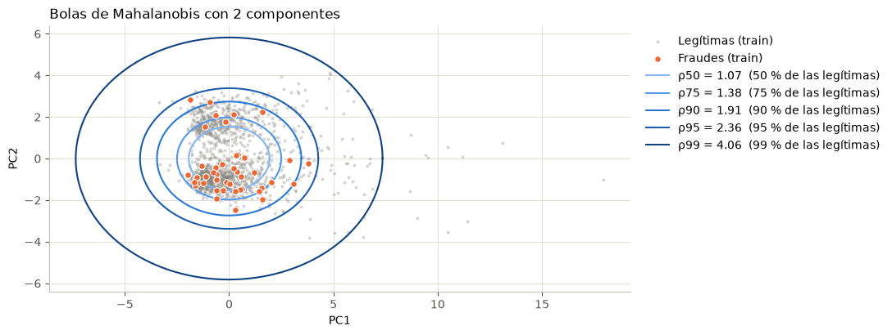
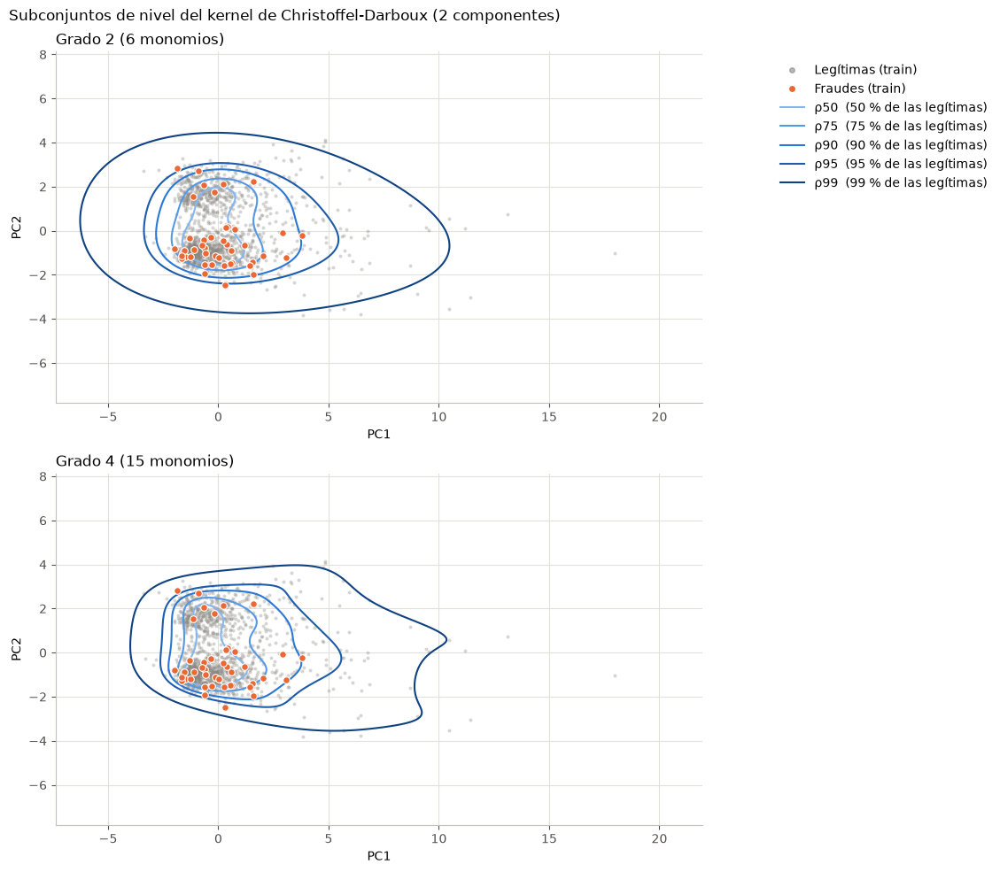

# Guía sencilla: Parte 3 (kernel de Christoffel-Darboux) y Parte 4 (entregables)

> Notas de estudio del proyecto *Detección de fraude financiero mediante el kernel de Christoffel-Darboux*.
> Todos los números y gráficas salen de la libreta `notebooks/data_procesing_and_modeling copy.ipynb`
> (división train/test con `random_state=42`). Los tiempos de ejecución cambian un poco en cada corrida.

---

## 0. Recordatorio: de dónde venimos

| | Total | Legítimas | Fraudes |
|---|---:|---:|---:|
| Transacciones de México | 1,921 | 1,869 | 52 |
| `X_train` (80 %) | 1,536 | 1,492 | 44 |
| `X_test` (20 %) | 385 | 377 | **8** |

- Estandarizamos las 26 columnas numéricas y aplicamos **PCA**. PC1 y PC2 explican el **22 %** de la varianza y las 10 componentes, el **66.7 %**.
- **Parte 2 (Mahalanobis):** dibuja **elipses** alrededor de las transacciones legítimas. Si una transacción queda fuera de la elipse, se marca como fraude.



**Qué se ve:** los puntos naranjas (fraudes) están **dentro** de las elipses, en la zona más densa de las legítimas. Por eso Mahalanobis casi no los detecta. Esta gráfica es la línea base para comparar con la Parte 3.

---

## Parte 3. Kernel de Christoffel-Darboux (CD)

### La idea en una frase

Mahalanobis siempre dibuja una **elipse**. El kernel CD dibuja una **frontera flexible** que se adapta a la forma real de los datos.

¿Por qué hace falta? En la gráfica de arriba, las legítimas **no** tienen forma de elipse: hay **dos grupos** (uno en PC2 ≈ 2 y otro en PC2 ≈ −1) y una **cola** que se estira hacia la derecha. Una elipse no puede seguir esa forma; un polinomio sí.

### Paso 1. Recodificar cada punto con potencias: Φ(x)

Cada transacción x = (x₁, x₂) se convierte en 6 números:

```
Φ(x) = (1, x₁, x₂, x₁², x₁·x₂, x₂²)
```

Ejemplo: x = (2, −1) → Φ(x) = (1, 2, −1, 4, −2, 1).

**Por qué:** es el mismo truco de la regresión polinomial. Con una recta no puedes ajustar una curva, pero si agregas x² sí. Con potencias y productos se pueden describir **fronteras curvas**.

### Paso 2. Resumir la forma de las legítimas: la matriz de momentos M

```
M = (1/N) DᵀD
```

`D` tiene un renglón Φ(x) por cada transacción legítima (N = 1,492). M es una **tabla de promedios de productos**: el promedio de x₁, de x₁², de x₁·x₂, de x₁²·x₂², etc. Esos promedios describen la **forma** de la nube: su centro, su dispersión y también si está cargada hacia un lado o tiene varios grupos.

> **Relación con Mahalanobis:** si solo usas Φ(x) = (1, x₁, x₂), M contiene únicamente la media y la covarianza, igual que Mahalanobis. En la celda 3.3 de la libreta se comprueba que en ese caso
> `p_CD(x) = 1 + distancia de Mahalanobis² (medida desde la media)`.
> El kernel CD es una **generalización** de Mahalanobis que usa más momentos.

### Paso 3. Un puntaje de "rareza": p_CD(x)

```
p_CD(x) = Φ(x)ᵀ M⁻¹ Φ(x)
```

Tiene la misma estructura que Mahalanobis (`xᵀ Σ⁻¹ x`), pero con Φ(x) en lugar de x y M en lugar de Σ.

- **p_CD pequeño:** x está donde hay muchas legítimas, así que se ve **normal**.
- **p_CD grande:** x está donde casi no hay legítimas, así que es **sospechoso**.

### Paso 4. La región "normal": subconjuntos de nivel y radios ρₙ

```
S_ρ = { x : p_CD(x) ≤ ρ }
```

Son todos los puntos con puntaje menor o igual que ρ. Igual que en la Parte 2, **ρ₉₅** es el umbral que deja dentro al 95 % de las legítimas de entrenamiento, y se calcula con la misma función `radio`.

> Los valores de ρ **no se comparan entre métodos**: el ρ₉₅ de Mahalanobis es 2.36, el del kernel CD de grado 2 es 12.78 y el de grado 4 es 36.11, porque cada método mide en su propia escala. Lo que sí se compara es **qué porcentaje de puntos queda dentro**.

### Paso 5. La regularización: M_reg = M + εI

A veces M no se puede invertir; es como intentar dividir entre cero. Sumar un número pequeñísimo (ε = 0.000001) a la diagonal lo evita, y en la libreta todos los cálculos usan M_reg.

### Paso 6. Grado 4: más flexibilidad

Con grado 4, la base tiene **15 monomios**: todos los x₁ᵃ·x₂ᵇ con a + b ≤ 4.

```
1, x1, x2, x1², x1·x2, x2², x1³, x1²·x2, x1·x2², x2³, x1⁴, x1³·x2, x1²·x2², x1·x2³, x2⁴
```

Más monomios permiten curvas más complicadas.

### La gráfica de la Parte 3



**Cómo leerla:** gris = legítimas, naranja = fraudes, y las curvas van de azul claro (ρ₅₀) a azul oscuro (ρ₉₉).

- **Grado 2 (arriba):** las curvas ya **no son elipses**. Se estiran hacia la derecha siguiendo la cola de los datos.
- **Grado 4 (abajo):** las curvas se pegan todavía más a los datos. La de ρ₉₉ rodea la cola con una forma irregular, parecida a la figura de la portada del PDF.
- **En ambas:** los fraudes siguen **dentro** de las regiones ρ₉₀ y ρ₉₅. La frontera es más realista, pero los fraudes no quedan afuera.

### Resultados con 2 componentes

**¿Qué porcentaje de los fraudes de entrenamiento queda dentro de cada región?**

| Umbral | % legítimas dentro | Mahalanobis | CD grado 2 | CD grado 4 |
|---|---:|---:|---:|---:|
| ρ₅₀ | 50 % | 38.6 % | 36.4 % | 43.2 % |
| ρ₇₅ | 75 % | 75.0 % | 75.0 % | 70.5 % |
| ρ₉₀ | 90 % | 93.2 % | 90.9 % | 90.9 % |
| ρ₉₅ | 95 % | 100 % | 95.5 % | 95.5 % |
| ρ₉₉ | 99 % | 100 % | 100 % | 100 % |

**Cómo leerla:** si el método funcionara, dentro de ρ₉₅ habría muchos menos fraudes que legítimas (por ejemplo, 95 % de las legítimas pero solo 10 % de los fraudes). Aquí los porcentajes son **casi iguales**: los fraudes se reparten en el espacio igual que las legítimas.

**Zonas de seguridad en `X_test` (kernel CD, grado 2):**

| Zona | Legítimas | Fraudes | % de fraude en la zona |
|---|---:|---:|---:|
| Seguridad extrema | 46 | 1 | 2.1 % |
| Seguridad alta | 44 | 1 | 2.2 % |
| Seguridad baja | 109 | 2 | 1.8 % |
| Peligro | 178 | 4 | 2.2 % |

En todo el conjunto de prueba hay 8 fraudes entre 385 transacciones, o sea **2.1 %**. Todas las zonas tienen alrededor de 2 %, así que **las zonas no distinguen nada**. Si el método funcionara, la zona "Peligro" tendría un porcentaje de fraude mucho más alto que las demás.

### Resultados con 5, 7 y 10 componentes: el problema del sobreajuste

El número de monomios de grado ≤ d con k componentes es **C(k + d, d)**, y crece muy rápido:

| Componentes | Grado | Monomios | Tiempo aprox. | % de legítimas de **test** dentro de ρ₉₅ |
|---:|---:|---:|---:|---:|
| 2 | 2 | 6 | 1 ms | 97.1 % |
| 2 | 4 | 15 | 2 ms | 96.8 % |
| 5 | 2 | 21 | 4 ms | 97.1 % |
| 5 | 4 | 126 | 21 ms | 95.0 % |
| 7 | 2 | 36 | 7 ms | 96.8 % |
| 7 | 4 | 330 | 72 ms | **84.4 %** |
| 10 | 2 | 66 | 14 ms | 94.7 % |
| 10 | 4 | 1,001 | ~280 ms | **25.2 %** |

**La última columna es la señal de alerta.** ρ₉₅ se calculó para que el 95 % de las legítimas de *entrenamiento* quedara dentro. Si el modelo generaliza bien, con legítimas *nuevas* (las de test) debería pasar algo parecido, cerca de 95 %.

- Hasta 5 componentes con grado 4, todo va bien (≈ 95–97 %).
- Con 7 componentes y grado 4 baja a 84 %.
- Con 10 componentes y grado 4 se desploma a **25 %**: tres de cada cuatro legítimas nuevas quedan **fuera** de la región "normal".

**Analogía:** es un traje hecho tan a la medida de las 1,492 transacciones de entrenamiento que ninguna transacción nueva "le queda". Con 1,001 monomios y solo 1,492 datos, el polinomio **memoriza** los datos de entrenamiento en lugar de aprender su forma general. A eso se le llama **sobreajuste**.

### Conclusión de la Parte 3

1. El kernel CD **sí dibuja fronteras más realistas** que la elipse: sigue los dos grupos y la cola de los datos.
2. Pero **no mejora la detección**, porque los fraudes están en la misma zona que las legítimas.
3. Subir el grado y el número de componentes hace crecer los monomios muy rápido, lo que lleva al **sobreajuste** y a más **tiempo de cómputo**.

### Preguntas del PDF de la Parte 3: pistas para responderlas a mano

| Pregunta | Pista |
|---|---|
| ¿Ves alguna relación de M con la distancia de Mahalanobis? | Piensa qué contiene M si la base es solo (1, x₁, x₂). La celda 3.3 lo comprueba numéricamente. |
| ¿p_CD determina una distancia al origen? ¿Los subconjuntos de nivel son bolas centradas en el origen? | ¿Cuánto vale Φ(0)? Entonces, ¿cuánto vale p_CD(0)? ¿Una distancia al origen debería valer 0 en el origen? Y mira la gráfica: ¿las curvas son círculos o elipses centrados en (0, 0)? |
| ¿Por qué M_reg siempre es invertible? | Calcula vᵀMv con M = (1/N)DᵀD: queda (1/N)‖Dv‖². ¿Qué signo tiene? ¿Qué pasa con los valores propios al sumar εI? |
| ¿Quién es la base de grado 4? | Todos los monomios x₁ᵃ·x₂ᵇ con a + b ≤ 4. Cuéntalos y compara con C(2 + 4, 4). |

---

## Parte 4. Entregables

### Qué piden

1. **Un reporte de una hoja** con el análisis comparativo de los métodos, evaluados en `X_test_pca`. Debe incluir:
   - tiempo de ejecución;
   - varianza explicada;
   - matriz de confusión en un renglón;
   - las gráficas en dos dimensiones;
   - conclusiones finales.
2. **Las respuestas a las preguntas del PDF**, escritas a mano.

### Cómo leer una "matriz de confusión en un renglón"

La regla de decisión es: **fraude si la transacción queda fuera de ρ₉₅**. Para cada transacción de prueba hay cuatro casos:

| Sigla | Qué era en realidad | Qué dijo el método | ¿Bien o mal? |
|---|---|---|---|
| **VN** (verdadero negativo) | legítima | legítima | ✅ |
| **FP** (falso positivo) | legítima | fraude | ❌ falsa alarma |
| **FN** (falso negativo) | fraude | legítima | ❌ fraude que se escapó |
| **VP** (verdadero positivo) | fraude | fraude | ✅ fraude detectado |

"En un renglón" significa escribir los cuatro números seguidos: `VN  FP  FN  VP`. De ahí salen dos porcentajes fáciles de explicar:

- **% de fraudes detectados** = VP / (VP + FN): de los 8 fraudes, cuántos atrapó.
- **% de falsas alarmas** = FP / (FP + VN): de las 377 legítimas, a cuántas acusó injustamente.

### La tabla comparativa (umbral ρ₉₅, sale de la celda 3.6)

| Método | Comp. | Base | Varianza explicada | Tiempo | VN | FP | FN | VP | % detectados | % falsas alarmas |
|---|---:|---|---:|---:|---:|---:|---:|---:|---:|---:|
| Mahalanobis | 2 | — | 22 % | < 1 ms | 363 | 14 | 8 | 0 | 0 % | 3.7 % |
| Mahalanobis | 10 | — | 67 % | < 1 ms | 358 | 19 | 7 | 1 | 12.5 % | 5.0 % |
| Kernel CD | 2 | grado 2 | 22 % | 1 ms | 366 | 11 | 8 | 0 | 0 % | 2.9 % |
| Kernel CD | 2 | grado 4 | 22 % | 2 ms | 365 | 12 | 8 | 0 | 0 % | 3.2 % |
| Kernel CD | 5 | grado 2 | 44 % | 4 ms | 366 | 11 | 8 | 0 | 0 % | 2.9 % |
| Kernel CD | 5 | grado 4 | 44 % | 21 ms | 358 | 19 | 8 | 0 | 0 % | 5.0 % |
| Kernel CD | 7 | grado 2 | 54 % | 7 ms | 365 | 12 | 7 | 1 | 12.5 % | 3.2 % |
| Kernel CD | 7 | grado 4 | 54 % | 72 ms | 318 | 59 | 7 | 1 | 12.5 % | 15.6 % |
| Kernel CD | 10 | grado 2 | 67 % | 14 ms | 357 | 20 | 7 | 1 | 12.5 % | 5.3 % |
| Kernel CD | 10 | grado 4 | 67 % | ~280 ms | 95 | **282** | 2 | 6 | 75 % | **74.8 %** |

### Cómo interpretar la tabla

- **Varianza explicada:** con más componentes conservamos más información (22 % → 67 %), pero eso **no** mejoró la detección.
- **Tiempo:** Mahalanobis tarda menos de 1 ms en todos los casos. El kernel CD tarda más cuantos más monomios tiene; con 1,001 monomios llega a cientos de milisegundos.
- **Detección:** casi todos los métodos atrapan **0 o 1 de los 8 fraudes**, con pocas falsas alarmas (3–5 %). En la práctica se comportan como si marcaran "legítima" a casi todo.
- **El caso engañoso:** el kernel CD con 10 componentes y grado 4 "detecta" 6 de 8 fraudes, pero solo porque marca como fraude **al 75 % de las legítimas**. Es el sobreajuste de la Parte 3. Un detector que acusa a 3 de cada 4 clientes honestos no sirve.
- **Cuidado con los porcentajes:** el test tiene solo **8 fraudes**, así que cada fraude vale 12.5 puntos de "% detectados". Una diferencia de 0 % contra 12.5 % es un solo fraude y puede deberse al azar.

### Ideas para las conclusiones del reporte

Adáptalas con tus palabras:

1. **Ningún método separa bien los fraudes en estos datos.** Con el umbral ρ₉₅ detectan 0 o 1 de 8 fraudes.
2. **La razón:** PCA es no supervisado, es decir, no usa la etiqueta `is_fraud`. Conserva las direcciones de mayor varianza, no las que distinguen el fraude. En esas componentes los fraudes **no son atípicos**: viven en la misma zona que las legítimas, como muestran las dos gráficas.
3. **El kernel CD describe mejor la forma de los datos** que la elipse de Mahalanobis, pero una mejor frontera no sirve si los fraudes están dentro de ella.
4. **Más grado y más componentes no siempre es mejor.** El número de monomios crece como C(k + d, d), y con 10 componentes y grado 4 el modelo sobreajusta: deja fuera al 75 % de las legítimas nuevas.
5. **Costo:** Mahalanobis es prácticamente instantáneo; el kernel CD con muchos monomios es cientos de veces más lento.
6. **Posibles mejoras:**
   - elegir variables que sí distingan el fraude, en lugar de solo las componentes de mayor varianza;
   - usar `stratify` en la división train/test;
   - tener más ejemplos de fraude para validar.

### Checklist para el reporte de una hoja

- [ ] Tabla comparativa con método, componentes, base, varianza explicada, tiempo y `VN FP FN VP`.
- [ ] Gráfica de Mahalanobis en 2D (elipses).
- [ ] Gráfica del kernel CD en 2D (grado 2 y grado 4).
- [ ] Decir qué umbral se usó (ρ₉₅) y que el test tiene solo 8 fraudes.
- [ ] De 3 a 5 conclusiones.
- [ ] Respuestas a mano de las preguntas del PDF.

### Nota: ¿por qué mis gráficas no se parecen a la figura del PDF?

En la figura de la portada del PDF, varios fraudes quedan **fuera** de las curvas. En nuestras gráficas no pasa eso. Hicimos una prueba con Mahalanobis en 2D:

| Cómo se hizo el PCA | Fraudes fuera de ρ₉₅ |
|---|---:|
| Sin `is_fraud` ni `fraud_amount_lost` (lo que hace la libreta) | 0 % |
| Incluyendo `fraud_amount_lost` | 2 % |
| Incluyendo `fraud_amount_lost` **e** `is_fraud` dentro del PCA | 32 % |

Una posible explicación es que la figura se hizo metiendo la etiqueta al PCA. Eso sería **fuga de información**: el modelo "ve" la respuesta. Por eso en la libreta **no** se incluyen esas columnas, y nuestros resultados son más honestos aunque se vean peor.
